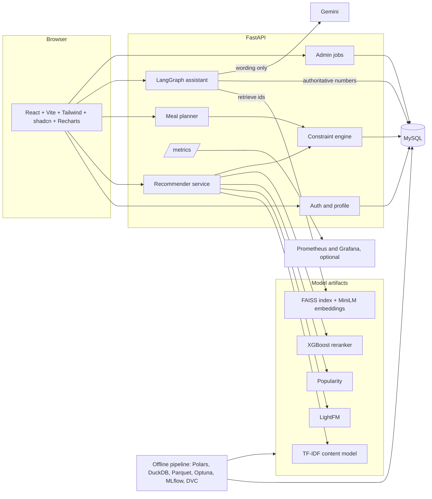

# NutriMate

An AI-based personalized food recommendation assistant using hybrid filtering, dietary
constraints and retrieval-augmented generative AI.

NutriMate recommends recipes and foods that fit a person's diet, allergies, goals and
taste. A hybrid recommender (content, LightFM and popularity) ranks recipes, a constraint
engine removes anything that breaks a hard rule, and an assistant answers nutrition
questions with numbers read from MySQL. Gemini only writes the wording around those
numbers; every number in a reply is checked against the database facts first.

## Features

- Sign up, sign in (JWT) and a four step onboarding: body details, diet and allergies,
  cuisine and taste preferences, daily targets (estimated from BMR and TDEE or set by hand).
- Recommendations with filters and like, dislike and save feedback. Hard rules (diet,
  allergies, restrictions, maximum calories) always win over the model score.
- Assistant chat. Questions about a food or recipe, comparisons, "what should I eat"
  and "how much do I have left today" are answered from MySQL. Gemini is optional.
- Meal planner for a day or a week, kept within 10% of the calorie target, with swap,
  save and "log this day". Breakfasts are checked to be breakfast dishes (see below).
- Food and recipe explorer with search, filters, smart (semantic) search and a compare
  tray for up to four items.
- Nutrition log, dashboard (7, 14 or 30 days), and history of searches, chats,
  feedback, plans and logs.
- Admin: upload or register datasets (CSV, TSV, JSON, JSONL, Parquet, Excel), clean and
  profile them as background jobs, import foods into MySQL, rebuild the search index, and
  read model and evaluation reports.

## Architecture



The assistant runs as a LangGraph graph: `parse_intent -> retrieve -> fetch -> compute ->
respond`. FAISS finds candidate recipe and food ids, the fetch step reads their values
from MySQL, the compute step does the arithmetic in Python, and the respond step either
asks Gemini to phrase the answer or fills a template. If Gemini's text contains a number
that is not in the database facts, the reply is replaced by the template answer and
marked as such in the UI.

## Data

- Food.com recipes and reviews: 522,517 recipes and 1,401,982 reviews.
- Indian Nutrient Databank (INDB 2024.11): 1,014 foods.
- USDA FoodData Central SR Legacy: 7,793 foods.

After cleaning there are 7,903 recipes in the catalogue (6,721 with enough ratings for
collaborative filtering plus 1,182 extra Indian recipes as cold start items), 225,842
ratings from 3,666 users, and 8,807 foods. `scripts/download_data.py` fetches all three
sources.

### Large files

Uploads and server side files are cleaned in a streaming way, so the whole file is never
in memory. CSV and TSV files are read in 4 MB blocks with the Arrow CSV reader and
cleaned in batches of about 64 MB with Polars, then written to Parquet. Column profiles
come from the Parquet statistics. `python -m ml.benchmark_ingest` builds a real 1.9 GB
CSV (every Food.com review joined to its recipe's text and nutrition columns) and
measures the ingest. Result on the build machine (Linux, 8 cores, 15 GB RAM, Python 3.11):

| File size | Rows | Columns | Time | Rows per second | Peak memory | Parquet output |
|---|---|---|---|---|---|---|
| 1,902 MB | 1,401,982 | 23 | 8.6 s | 163,021 | 797 MB | 382 MB |

The same file registered through the admin page and processed as a background job took
9.1 s. Expect slower numbers on a laptop disk.

## Results

All numbers below come from `reports/metrics.json` and the other files in `reports/`,
produced by `python -m ml.evaluate` on a per user temporal split (first 70% of each user's
ratings for training, next 10% validation, last 20% test). A rating of 4 or 5 counts as
liked. 3,665 test users, 6,721 candidate recipes, 43,287 test ratings.

| Model | Precision@10 | Recall@10 | NDCG@10 | Hit rate@10 | Coverage |
|---|---|---|---|---|---|
| Popularity | 0.0227 | 0.0257 | 0.0296 | 0.1935 | 0.0079 |
| Content (TF-IDF) | 0.0047 | 0.0049 | 0.0058 | 0.0445 | 0.3678 |
| LightFM | 0.0230 | 0.0262 | 0.0299 | 0.2003 | 0.0629 |
| LightFM fold in | 0.0237 | 0.0259 | 0.0305 | 0.2000 | 0.0254 |
| NCF (PyTorch) | 0.0184 | 0.0203 | 0.0241 | 0.1640 | 0.2556 |
| Hybrid | 0.0253 | 0.0275 | 0.0328 | 0.2128 | 0.0312 |
| Hybrid + XGBoost rerank | 0.0261 | 0.0281 | 0.0337 | 0.2207 | 0.0553 |

Cold start, where each test user is given only three liked recipes:

| Model | Precision@10 | NDCG@10 | Hit rate@10 |
|---|---|---|---|
| Popularity | 0.0198 | 0.0254 | 0.1746 |
| Content | 0.0036 | 0.0046 | 0.0344 |
| LightFM fold in | 0.0176 | 0.0228 | 0.1599 |
| Hybrid | 0.0180 | 0.0237 | 0.1613 |

Constraint engine, 500 random profiles with 10 recommendations each: 0 of 5,000
recommendations broke a rule with the filter on, against 3,680 of 5,000 (73.6%) with it
off. The same matcher decides both, so this shows the filter is applied everywhere, not
that the matcher is complete; the matcher itself is covered by the allergen tests.

Notes on these numbers:

- Absolute values are low. Food.com users rate a few dozen recipes out of thousands, and
  80% of ratings are 5 stars, so popularity is a strong baseline. The hybrid beats it,
  but not by much.
- The hybrid weights (content 0.23, LightFM 0.48, popularity 0.29) and the LightFM
  settings were tuned with Optuna on the validation split (validation NDCG@10 0.0257 for
  the hybrid, 0.0239 for LightFM alone).
- The XGBoost reranker scored slightly higher on the test split, but on a validation
  holdout it was worse than the plain hybrid order (0.0253 against 0.0279). The app
  follows the validation result and serves the hybrid order. Set `RERANKER=on` in `.env`
  to try it.
- App users are scored with LightFM fold in (their likes are projected into the item
  space), which is why that row is reported separately.
- LightFM trains with several threads, so two runs on the same data give slightly
  different numbers. Rerunning the pipeline after the allergen update moved LightFM
  NDCG@10 from 0.0313 to 0.0299 and the hybrid from 0.0332 to 0.0328, with identical
  ratings and split. Treat differences of this size as noise.
- Training all models takes about 7 s and the full evaluation about 3 minutes on the
  build machine (it was about 1 minute on a less loaded run). The FAISS index (16,710
  documents, 384 dimensions) takes about 30 s.

## Project layout

```
backend/        FastAPI app, SQL scripts, seed scripts and tests
  app/rag/      LangGraph assistant, FAISS retriever, Gemini wrapper
  app/services/ recommender engine, constraint rules, planner, background jobs
  sql/          setup_db.sql (database and user), schema.sql (tables)
ml/             ingest, preprocess, split, tune, evaluate, train, build_index
nutrimate_core/ shared constraint rules, paths and nutrition helpers
frontend/       React app
scripts/        download, rebuild (sh and ps1), UI click-through
monitoring/     Prometheus config and Grafana dashboard
reports/        evaluation and benchmark output (JSON)
models/         trained artifacts (not in git)
data/           raw, interim and processed data (not in git)
```

## Setup on Windows

You need Python 3.11, Node.js 20 or newer, MySQL 8 and Git. The commands are for
PowerShell from the project folder.

1. Create the database and the app account. Edit the password in
   `backend\sql\setup_db.sql` first, then:

   ```powershell
   Get-Content backend\sql\setup_db.sql | mysql -u root -p
   ```

   The tables are created by the API on its first start (`backend\sql\schema.sql`).

2. Create the environment file and fill it in:

   ```powershell
   Copy-Item .env.example .env
   python -c "import secrets; print(secrets.token_urlsafe(48))"   # paste as JWT_SECRET
   ```

   Put the MySQL password from step 1 in `MYSQL_PASSWORD`. `GEMINI_API_KEY` is optional.

3. Python environment:

   ```powershell
   py -3.11 -m venv .venv
   .\.venv\Scripts\Activate.ps1
   python -m pip install --upgrade pip
   pip install torch --index-url https://download.pytorch.org/whl/cpu
   pip install -r requirements.txt -r requirements-dev.txt
   ```

   On the RTX laptop you can install the CUDA build of torch instead; only the NCF
   baseline uses it.

4. Data and models. The zip ships `data\processed` and `models`, so you can skip
   training and go straight to loading MySQL:

   ```powershell
   python -m backend.scripts.load_catalogue
   python -m backend.scripts.seed_demo
   ```

   To rebuild everything from the public sources instead, install the training extras
   (see "LightFM on Windows" below) and run `.\scripts\rebuild.ps1` (add `-NoTune` to
   skip Optuna).

5. Start the API:

   ```powershell
   uvicorn backend.app.main:app --host 127.0.0.1 --port 8000
   ```

   The first start downloads the MiniLM embedding model (about 90 MB) once.

6. Start the frontend in a second window:

   ```powershell
   cd frontend
   npm install
   npm run dev
   ```

   Open http://localhost:5173. The dev server forwards `/api` to port 8000.

Demo accounts created by `seed_demo` (change them with the `SEED_*` values in `.env`):

- admin@example.com / admin12345 (admin)
- demo@example.com / demo12345 (a user with 30 days of history)

### LightFM on Windows

LightFM has no wheels on PyPI and its 1.17 source release fails to build with current
pip, so it is installed from its Git repository. This is only needed to train; the app
itself loads the saved embeddings and does not import LightFM.

1. Install "Build Tools for Visual Studio" with the "Desktop development with C++"
   workload (the MSVC compiler and Windows SDK).
2. Open a new PowerShell window, activate the venv and run:

   ```powershell
   pip install -r requirements-train.txt
   pip install "git+https://github.com/lyst/lightfm@master"
   ```

   Check it with `python -c "import lightfm; print(lightfm.__version__)"`. On Windows
   LightFM builds without OpenMP, so training uses one thread; it still finishes in well
   under a minute on this data.

## Training, DVC and MLflow

The pipeline is defined in `dvc.yaml` with parameters in `params.yaml`:

```powershell
dvc repro            # runs only the stages whose inputs changed
dvc dag              # shows the stage graph
dvc metrics show     # prints reports\metrics.json
```

Stages: ingest, preprocess, split, tune, evaluate, train, build_index. Each stage can
also be run on its own, for example `python -m ml.evaluate`.

Every tuning, evaluation and training run is logged to MLflow in `mlflow.db`:

```powershell
mlflow ui --backend-store-uri sqlite:///mlflow.db --port 5000
```

Then open http://127.0.0.1:5000. Model artifacts are also saved with Joblib and NumPy
in `models\`, which is what the API loads.

## Tests

The tests use their own database (`nutrimate_ai_test`, created by `setup_db.sql`) and
refuse to run against a database whose name does not end in `_test`.

```powershell
pytest -q                       # full suite, needs data\processed and models
$env:NUTRIMATE_TEST_LIGHT = "1"; pytest -q   # CI mode: small fixture catalogue
ruff check .
cd frontend; npm run lint; npm run build
```

The suite covers sign up and sign in, onboarding, hard rules overriding scores,
recommender output, planner calorie tolerance and rule clean plans, breakfast checks
across ten diet and allergy profiles, allergen and diet matching (true positives and
false friends), assistant values matching MySQL, the admin dataset job and history.
`python scripts/check_breakfasts.py` prints the breakfasts of a week plan for twelve
profiles and writes `reports/breakfast_check.json`. One test calls the real Gemini API;
it runs only when `GEMINI_API_KEY` is set and is skipped otherwise.

`scripts/ui_clickthrough.py` uses Playwright to click through every page and save
screenshots (`pip install playwright` then `playwright install chromium`).

GitHub Actions (`.github/workflows/ci.yml`) runs ruff and the light test suite against
the MySQL server that comes with the Ubuntu runner, and lints and builds the frontend.
Tests that need the trained models are skipped there because the artifacts are not in
git.

## Monitoring (optional)

The API exposes Prometheus metrics at http://127.0.0.1:8000/metrics: request counts and
latency per route, recommendation time, retrieval and Gemini latency, assistant replies
by mode, background jobs and loaded models.

1. Download Prometheus for Windows, unzip it and run
   `prometheus.exe --config.file=<project>\monitoring\prometheus.yml`.
2. Install Grafana for Windows, open http://localhost:3000, add Prometheus
   (http://localhost:9090) as a data source and import
   `monitoring\grafana_dashboard.json`.

## Known limits

- Allergen and diet checks are text matching on the recipe name, ingredients and steps.
  Each group has a synonym list with English and Indian names (for example groundnut
  and moongphali for peanut, ghee, khoya and paneer for dairy, maida, atta and sooji for
  gluten, til and gingelly for sesame), matched on word boundaries with plurals. Phrases
  that say the thing is absent ("dairy-free milk", "eggless", "vegan butter") and known
  false friends ("peanut butter" for dairy, "eggplant", "nutmeg", "coconut", "water
  chestnut") are removed first. A recipe that hides an allergen under a name not on the
  list can still slip through, and oats are not treated as gluten. The app says an
  allergen was "not found in the listed ingredients", never that a dish is safe. This
  is a recommendation aid, not medical advice.
- Unspecified bouillon, stock cubes and gelatin count as non-vegetarian, and honey and
  ghee as non-vegan, so some vegetarian recipes that use vegetable bouillon without
  saying so are left out.
- Breakfast suitability is a rule set over names, Food.com tags and per serving bounds
  (60 to 900 kcal, at least 3 g protein), in `nutrimate_core/meals.py`. It blocks
  pasta, noodles, curries, soups, salads, steaks, desserts, toppings and cocktails, and
  needs a breakfast word or tag. When a strict profile leaves too few breakfast
  recipes, the planner and the recommendations page add light dishes that are not
  tagged as breakfast after the real ones and label them "fallback breakfast". Vegan
  profiles with several allergies get a narrow set, mostly oats, granola, smoothies and
  potato dishes.
- Food.com has few Indian dishes, so 1,182 Indian recipes were added as cold start
  items without ratings. Some dishes (paneer in particular) have thin coverage.
- Food.com nutrition is per serving and serving sizes vary. 176 recipes with missing or
  implausible nutrition are flagged and kept out of planning.
- Without a Gemini key the assistant still works, using template answers.
